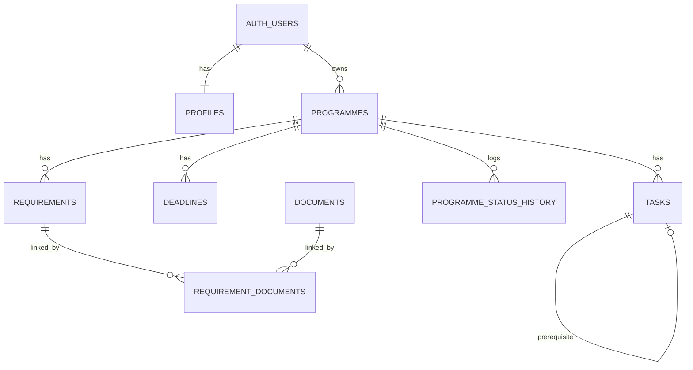

# GradPath Atlas — Product Requirements Document (PRD)

| Field | Value |
| --- | --- |
| Product | **GradPath Atlas** — master's application planning workspace (desktop-first web app) |
| Document version | 0.1 — Build Phase 0 (specification only) |
| Date | 2026-10-25 |
| Course / assignment | MKTG 4150 New Product Management, Team Assignment 1 (Web Application), hypothetical business "GradPath Atlas" (Brief p.3, p.11) |
| Author | AI-assisted draft (Claude Code), to be reviewed and critically assessed by the student. Student name / ID: **[to be supplied by the student; not committed publicly]** |
| Status | **No application code, dependencies, migrations or deployment exist yet.** Everything below is a plan. |
| Companion files | `tasklist.md` (ordered, gated tasks), `CLAUDE.md` (agent rules), `README.md` (setup and submission checklist) |

---

## 0. How to read this document

### 0.1 Evidence labels

Every substantive claim carries one of these labels so supplied evidence is never confused with assumptions.

| Label | Meaning |
| --- | --- |
| **[Src]** | Stated in the supplied brief or lecture files. A citation follows, e.g. `Brief p.11` or `L7 p.30 (L7:S33)`. |
| **[Asm]** | Assumption or hypothesis proposed here. **Not validated.** Persona details, prices, targets and experiments are all [Asm] unless a source is cited. |
| **[Dec]** | Design or engineering decision taken in this PRD. |
| **[Pend]** | A result that does not exist yet (tests, interviews, deployments). Nothing marked [Pend] has been performed. |

Citation format: `Brief p.N` is the printed page of the assignment PDF (printed and PDF page numbers match). `Ln p.N (Ln:Sxx)` is the PDF page of lecture *n*, followed by the instructor's own slide label where it is readable. The L5 deck's slide labels read `L4:S…` (a labelling slip in the source), so L5 is cited by PDF page only.

### 0.2 Terminology: two different "phases"

* **Build Phase 0–8** — the staged way this project is built with an AI coding agent (table in §2.5). One phase per run, then stop.
* **Post-MVP ("the brief's Phase 2")** — features deliberately deferred until after a working MVP (§2.4). The brief uses "Phase 1 Core MVP / Phase 2 Post-Launch Expansion" (Brief p.33).

### 0.3 Source register

Files supplied in the project folder. "Read" means text was extracted with `pdftotext` and read in full unless stated.

| Short ref | Exact filename | How read | Notes |
| --- | --- | --- | --- |
| Brief | `MKTG 4150 NPM 2627 T1 Assignment 1 Web App Instructions.pdf` (47 pp.) | Text read in full for pp.1–19, 28–29, 32–47. Pp.20–27 and 30–31 (prompts for the other five businesses) were located but **not read** — not relevant to GradPath Atlas (Brief p.13). | Required pages pp.1–4, 11, 28–29, 32–43 all read. |
| L1 | `Lecture/MKTG 4150 T1 2627 L1 NPM Color1.pdf` | Text read in full (84 pp.) | Value proposition, disruptive innovation, solopreneurs. |
| L2 | `Lecture/MKTG 4150 T1 2627 L2 Competitive Positioning Color1.pdf` | Text read in full (77 pp.) | Positioning, pain points, painkiller rubric, pain math. |
| L3 | `Lecture/MKTG 4150 T1 2627 L3 7 Day MVP PRD Color1.pdf` | Text read in full (56 pp.) | 7-day MVP, PRD/tasklist, prompt architecture. |
| L4 | `Lecture/MKTG 4150 T1 2627 L4 Canvas Color1.pdf` | Text read in full (104 pp.) | CLV, Business Model / Value Proposition / Lean Canvas. |
| L5 | `Lecture/MKTG 4150 T1 2627 L5 PLC & Design Thinking Color1.pdf` | Text read in full (97 pp.) | PLC, beachhead, design thinking. |
| L6 | `Lecture/MKTG 4150 T1 2627 L6 Innovation & Stress Test Color1.pdf` | Text read in full (119 pp.) | Innovation charter, lean startup, stress tests. |
| L7 | `Lecture/MKTG 4150 T1 2627 L7 Pricing & Basic Startup Math Color1.pdf` | Text read in full (98 pp.) | Pricing, willingness to pay, startup maths. |
| Prompt | `claude-code-gradpath-atlas-prompt.md` (in `D:\Downloads`, **outside** the project folder) | Read in full | The user's build instructions. Not committed to the repo. A file called `prompt.md` was requested but does not exist in the project folder. |

**Limits of the reading [Pend/honest]:** many slides are images (charts, diagrams, canvases, videos). Those pages extracted as empty or caption-only text and were **not inspected visually** (for example L5 pp.26–27, 29, 44, 46; L6 pp.6, 19, 27, 31, 34, 43–44; L7 pp.11, 24, 41, 53, 81, 83, 88). No decision in this PRD relies on content that exists only in those images. Embedded YouTube videos were not watched.

### 0.4 Missing materials, conflicts and open assumptions

| ID | Item | Handling |
| --- | --- | --- |
| A-01 | **AI-use cap.** Brief p.3 still prints "contribution … must not exceed 50%" and "You must NOT use A.I. to complete the entire assignment". The student states this cap and prohibition have been lifted. | Proceeding on the student's instruction. The printed PDF is what is submitted against, so the student should keep written confirmation from the instructor. The declaration sentence on Brief p.3 is a **blank placeholder**; no percentage is invented here. Failure to declare AI use is penalised (Brief p.3). |
| A-02 | **Due date.** Brief p.1 prints "11:00 p.m. 18 October 2026 (Sunday)" in one place and "(Monday)" in another. The system date for this work is 2026-10-25, after the printed date. Late penalty is 100% after 30 minutes (Brief p.1). | The printed date is **not assumed to be the active deadline.** The student must confirm the current deadline and any extension with the instructor. |
| A-03 | Missing course material: **"MKTG 4150 NPM Vibe Coding Prompt Template"** (manual referenced at Brief pp.34, 36, 38 and L3 pp.9–12, 19, 21, 30, 34, 37, 42–48). | Not available. Only the prompt text printed in the brief was used. |
| A-04 | Missing: the instructor's separate credit pilot-test document (Brief p.5); lecture recordings; the vibe-coding practical lessons listed on agendas ("Idea to First Screen", "Prompting as a Discipline", "Digital Product Technical Stack", "Quality Control: Gauntlet Loop", "Preparation of Assignment 2") — their slides are not in the supplied PDFs. | Not used. If supplied later, targeted updates will be made rather than restarting. |
| A-05 | The brief's template stack (Drizzle ORM, Clerk, Stripe, ImageKit, Gemini; Brief pp.33–34) is **guidance, not a requirement.** Brief p.5: "You may use any coding, low-code, no-code, or CMS tools you prefer. The specific web app builder, version control platform, and hosting provider you choose are NEVER part of the assessment." | Deviations are explained in §4.4. |
| A-06 | The brief suggests cookie-consent banners (Brief p.33). | This app sets only strictly necessary session cookies and no analytics, so a banner would control nothing. Explained in §7.4. A non-functional banner is not added. |
| A-07 | L2 p.64 (L2:S88) warns that "targeting both B2B and B2C markets with one product is a mistake because their needs differ". The brief's concept (Brief p.11) combines student passes with institutional licences. | Recorded as a commercial risk. The MVP serves one user type (students); the adviser/university tier is an enquiry-only placeholder (§1.6, §1.8). |
| A-08 | "Seasonal pricing" is **not a topic with its own lecture slide.** Seasonality appears in Brief p.11 ("Usage varies seasonally, and students are price-sensitive"). | The season-pass decision is derived from Brief p.11 plus L7 pp.30–32 (pricing models); no lecture slide is cited for seasonality itself. |
| A-09 | Private repository: Brief p.4 says to invite the instructor (address printed on Brief p.4) as a collaborator. | Documented in `README.md`. The invitation is the student's manual action. |

### 0.5 Critical-assessment log (AI draft vs sources)

The brief requires the student to "use your critical thinking to assess the AI-generated responses" (Brief p.4). Points where the AI draft was checked or corrected against the sources — **to be confirmed or amended by the student:**

1. The brief's template stack (Clerk/Stripe/Drizzle…) was *not* copied; a smaller Supabase-only stack was chosen (A-05, §4.4).
2. The L2 painkiller rubric (L2 pp.61–63) was applied **strictly** (evidence = 1, belief = 0), so GradPath currently scores **0/5 evidenced** (§1.7). That is uncomfortable but honest.
3. The price points are placeholders that L6 p.95 (L6:S98) warns against stating without evidence ("Do not invent a price with no evidence; treat price as a testable assumption"); they are labelled [Asm] and tied to a test (§1.6, §2.6).
4. Personas are archetypes (L5 p.72) with no interviews behind them; marked [Asm].
5. "Seasonal pricing" has no lecture slide of its own (A-08).
6. No competitor facts are asserted; no competitor research has been done.

---

## 1. Executive overview and personas

### 1.1 Problem and value proposition

**Problem [Src, Brief p.11]:** undergraduates applying to several master's programmes keep requirements, documents, deadlines and pending tasks in scattered spreadsheets, emails and notes. The student cannot easily see what is missing or which document can be reused.

**Solution-free problem statement** (format from L5 p.76): *When applying to several master's programmes, a final-year undergraduate needs to see which requirements, documents and deadlines are still outstanding for each programme, and is dissatisfied with spreadsheets, email and notes because they hold unlinked information that does not show what is missing, what can be reused, or what blocks what.* [Asm]

**Value proposition** (the seller's statement, L1 pp.7–8): **"Compare your master's applications and see what to do next in one workspace."**

**Reference product [Asm]:** the student's current spreadsheet + notes + email workaround. Customers compare a new offer with a familiar reference (L1 p.21, L1:S45; L1 pp.24–26). Spreadsheets cost nothing and are flexible, so GradPath must beat them on *what's missing* and *document reuse*, not on storing rows.

**Total get / total give (L1 pp.14–23) [Asm]:**

| Get (benefit) | Give (cost to the customer) |
| --- | --- |
| Functional: side-by-side requirements; deadline order; reusable documents linked to requirements; clear "missing" list. Emotional: reassurance of not missing an item. | Money (free tier / one-off pass), **data-entry time and learning effort**, switching from an existing spreadsheet, and privacy risk of storing application details. |

The largest "give" is data-entry effort; fictional sample data (so a user can *see* the loop before typing) and CSV export (no lock-in) are the planned mitigations.

### 1.2 Customers and personas (all [Asm] — archetypes, no interviews)

Archetypal personas summarise research into names and attributes (L5 p.72). **No primary research supports these.** They exist to guide design and must be replaced by interview findings (§2.6).

| Persona | Role | Context and goals [Asm] | Pains [Asm] |
| --- | --- | --- | --- |
| **P1 — "Maya" (primary user)** | Final-year undergraduate | Applying to 4–6 master's programmes in 2–3 countries; deadlines cluster in one season; wants to know what to do next. | Requirements differ per programme; same transcript/statement reused with edits; fears missing a deadline; reference letters depend on referees. |
| **P2 — "Daniel" (secondary buyer)** | Education adviser | Supports many students per season; wants a quick read of a student's readiness. | Cannot see a student's plan at a glance; repeats the same checklist advice. |
| **P3 — "Careers team lead"** | University careers / progression team | Wants consistent support for a cohort. | Hard to scale one-to-one advice. |

Brief p.11: "Students may pay for short-term access, but careers services, education advisers and universities are more reliable potential customers." [Src]

**Early-adopter / beachhead hypothesis [Asm]** (L4 pp.68–69; L5 pp.49–52): final-year undergraduates at one institution who are applying to three or more programmes and who already maintain a spreadsheet workaround. A beachhead is a narrow staging segment relying on word of mouth (L5 pp.50–52). Size and reachability are unknown.

### 1.3 Jobs, pains, gains → features (Value Proposition Canvas, L4 pp.37–46)

| Customer job / pain / gain [Asm] | Pain reliever / gain creator | Feature | Req IDs |
| --- | --- | --- | --- |
| *Job (functional):* decide which programmes to pursue. | Compare programmes side by side with differences highlighted. | Comparison matrix | CMP-01…05 |
| *Pain (information friction):* requirements are scattered. | One record per programme with typed requirements. | Programme + requirement records | PRG-01…07, REQ-01/02 |
| *Pain (missed documents):* cannot tell what is missing. | Readiness computed from linked, valid documents. | Document tracker + readiness | DOC-01…05, RDY-01/02 |
| *Pain (duplicate work):* same document reused. | One document linked to many requirements. | Reusable document records | DOC-02/03 |
| *Pain (missed deadline):* risk of losing an application. | Chronological, grouped deadlines; due-today ≠ overdue. | Deadline tracker | DL-01…05 |
| *Pain (sequencing):* a task can't start before another. | Prerequisite tasks; blocked vs actionable. | Task list | TSK-01…05 |
| *Gain (desired):* know what to do next. | Ordered next-action list. | Dashboard | DSH-01…04 |
| *Social job:* show an adviser a clear plan. | Read-only adviser-review preview + export. | `/adviser`, export | ADV-01, EXP-01…03 |

### 1.4 Competitive positioning (L2 pp.10–14)

No competitor research has been performed and no competitor facts are asserted here. Generic categories only [Asm]: spreadsheets and notes, email folders, general to-do/project tools, university application portals (each covers only its own programme).

| Concept (L2 p.13, L2:S16) | GradPath position [Asm] |
| --- | --- |
| **Category points of parity** (needed to be a legitimate planner) | Account + private data; list of programmes; deadlines; task list; export. |
| **Competitive point of parity** (neutralise the spreadsheet's strength) | Spreadsheet flexibility → free tier, fast start with sample data, CSV/JSON export (no lock-in). |
| **Correlational point of parity** (twist an apparent drawback) | "A structured tool means more typing" → sample data, sensible defaults, "unknown" allowed so users can start with little. |
| **Point of difference** (hard to copy; L2 p.11) | Requirement-level document readiness with reuse across programmes, and transparent, recomputed progress. (A feature can be copied; durability of this advantage is unproven — L6 p.100.) |

PDB triangle (L2 pp.17–20) [Asm]: *Positioning* (mind share) = "the planner that shows what's missing"; *Differentiation* (market share) = comparison matrix + readiness; *Brand* (heart share) = calm, trustworthy, no pressure tactics.

No disruption claim is made: Christensen-style disruption means serving overlooked segments with simpler products, and "not all successful innovations are disruptive" (L1 p.43, L1:S68).

### 1.5 Lean Canvas snapshot (L4 pp.60–78; fill order L4 p.66)

| Block | Content [Asm] |
| --- | --- |
| Customer segments / early adopters | Final-year undergraduates applying to ≥3 master's programmes; spreadsheet users. |
| Problem / existing alternatives | Scattered requirements, documents, deadlines; spreadsheets/notes/email. |
| Unique value proposition / high-level concept | "Compare your master's applications and see what to do next in one workspace." Concept: *a spreadsheet that knows which documents are missing.* |
| Solution | Programme records, comparison matrix, reusable document readiness, tasks with prerequisites, deadlines, dashboard, export. |
| Channels | To be tested; candidates: peer word of mouth, adviser/careers offices. Nothing is proven. |
| Revenue streams | One-off season pass; institutional licence enquiries (§1.6). |
| Cost structure | Hosting/database free tiers during the prototype; **no cost figures are asserted** — check current provider pricing before any launch. |
| Key metrics (AARRR, L4 p.77) | Activation: sign-up → first programme → first document linked → first export. Retention: returns in a later week of the same season. Revenue: simulated-plan clicks are *interest only*, not revenue. |
| Unfair advantage | **None yet.** (L6 p.100: features and passion do not count.) |

### 1.6 Monetisation (hypothetical; nothing is charged)

Three pricing decisions (L7 p.5, L7:S8): the price, the pricing model, and the pricing strategy by segment/stage. The model matters more than the price (L7 p.8).

| Tier | Hypothetical price [Asm] | Duration | Feature difference (for the future real product) |
| --- | --- | --- | --- |
| **Free basic planning** | US$0 | Unlimited | Up to 3 programmes; comparison of up to 3; JSON/CSV export. |
| **Season pass** | **US$19**, one-off | One application season = 9 months from activation (Sep–May cycle assumed) | Unlimited programmes; comparison of up to 6; all exports; print summary. |
| **Adviser / university licence** | **Enquiry only.** Planning figure: US$400 per season for up to 50 student seats (≈US$8/seat) | One season | Cohort support; adviser review; shared access is **Post-MVP** — not built. |

**Prototype rule [Dec]:** every core feature stays testable by every user. The tier differences above describe the future product and are *not enforced*. Upgrading is a **simulation only** (§6.3): no card fields, no processing, no real entitlement.

**Rationale and honesty:**
* *Model:* a one-off, pay-now season pass is the "transactional" model (L7 p.30, L7:S33). It fits the brief's seasonal usage and price-sensitive students (Brief p.11); a monthly subscription (L7 pp.31–32) would charge for idle months. Seasonality itself has no lecture slide (A-08).
* *Price:* the lower bound for value is the "next-best alternative" — a free spreadsheet at ≈US$0 plus value of incremental benefits minus drawbacks (L7 p.13, L7:S16). The upper bound (willingness to pay) is **unknown**. US$19 is a placeholder to be tested with the price-sensitivity and purchase-probability methods (L7 pp.15–19, L7:S18–S22) in §2.6. Do not treat as evidence.
* *Strategy:* free tier as reference/penetration (L7 p.36, L7:S39: "Only 1 to 2 per cent of freemium users typically convert"); no decoy pricing, countdown timers or fake scarcity — scarcity is only persuasive when genuine (L6 p.4, L6:S7) [Dec].
* *Licence price:* pure planning figure with no supporting evidence; B2B pricing should be tested with advisers (L2 p.64).

**Illustrative startup maths (L7 pp.40–71) — all inputs are assumptions:**

| Step (formula source) | Calculation |
| --- | --- |
| Minimum success criteria, framed as ARR (L7 pp.40, 44–45, 50) | Assumed 3-year target **US$100,000 ARR** ("roughly enough to quit your day job", L7 p.50). |
| Student-only: active customers = ARR ÷ ARPU (L7 p.55) | 100,000 ÷ 19 = 5,263.2 → **5,264 paying students per year** (a season pass is bought once per season, so ARPU ≈ US$19). |
| Customer lifetime / churn (L7 pp.63–65) | A student's "job" lasts about one season, so effectively **all passes must be re-acquired each year** — about 5,264 new paying customers a year (≈439 a month). |
| Leads needed = customers ÷ conversion; assume 1% when unsure (L7 pp.67, 71) | 5,264 ÷ 1% = **526,400 leads a year** (≈43,900/month). At the 1–2% freemium conversion of L7 p.36: 263,200–526,400 free sign-ups a year. |
| Referral loop (L7 pp.73–74) | If 20% of leads came by referral: 105,280 referred, 421,120 still to acquire. |
| Licence-only: ARR ÷ licence price | 100,000 ÷ 400 = **250 licences a season**. |
| Mixed example | 100 licences (US$40,000) + 3,158 passes (US$60,002). |

Reading: a student-only business needs a very large funnel because the customer lifetime is short; institutional licences are strategically important (consistent with Brief p.11) but conflict with L2 p.64's warning against serving B2B and B2C with one product (A-07). **This is a commercial risk to acknowledge, not a validated plan.** The 2,286-firms example in L7 pp.60, 70 is the lecture's hypothetical and is not reused.

### 1.7 Pain severity and stress-test status

**Painkiller rubric (L2 pp.61–63, L2:S85–S87).** Score 1 only if "objectively true with evidence", 0 if "uncertain/belief". Decision rule: 4–5 grants permission to build; ≤3 means pivot.

| Dimension | Plausible hypothesis [Asm] | Evidence today | Score |
| --- | --- | --- | --- |
| Financial impact | A missed application costs a year or fees. | None | 0 |
| Workflow criticality | A missing document can block an application. | None | 0 |
| Frequency (≥ weekly) | Weekly during the application season. | None | 0 |
| Existing budget line | Students/families already pay advisers or agents. | None | 0 |
| 24-hour regret test | Users would object if the tool were removed. | None | 0 |
| **Total evidenced** | | | **0 / 5** |

By the rubric's strict rule this idea has not yet earned "permission to build" as a business. It is built here as a **coursework prototype**; the validation plan (§2.6) is how the score would be earned. This is stated plainly because L2 p.38 (L2:S44) notes that surveys and interviews are flattering and payment before delivery proves validity.

**Stress test checkpoints (L6 pp.77–78, 90, 105, 117; Pass / Pivot / Park):**

| Test | Question (L6 p.78) | Status |
| --- | --- | --- |
| Desirability | Will customers want this enough to act? | **Not tested.** No interviews or commitments. Cannot Pass. |
| Viability | Can you monetise value from customers? | **Not tested.** Price and payer are assumptions; no commitment path. |
| Feasibility | Can you build and deliver the offer? | **Plausible, unproven.** Scope is a deliberately small stack (L6 p.107 "must-haves only"). Proof comes only from the phased build passing its gates. |

Product Innovation Charter (L6 pp.21–22, four parts) is covered by: Background = §1.1; Focus arena = §1.2/§1.4; Goals = §2.2/§2.6; Boundaries/guidelines = §2.3 and `CLAUDE.md`.

### 1.8 Course source → product decision table

"Basis" shows whether the course file *supports* the decision or only *inspires* it. A course concept never proves a GradPath fact.

| Source (file · page) | Concept | GradPath decision | Basis |
| --- | --- | --- | --- |
| L1 pp.14–23 (L1:S38–S47) | Value equation; total get/total give; mental trade-offs | Value proposition framed as get vs give; data-entry effort named as main give (§1.1). | Concept [Src]; application [Asm] |
| L1 pp.21, 24–26 (L1:S45, S48–S50) | Reference product; anchoring | Spreadsheet treated as reference; free tier shown as the anchor. | Concept [Src]; application [Asm] |
| L1 p.43 (L1:S68) | Not all innovation is disruptive | No disruption claim. | [Src] |
| L1 pp.61–66 (L1:S87–S92) | "Simplicity wins": solve one tiny problem | Keep MVP to the value loop; many features rejected (§2.3). | Concept [Src] |
| L2 pp.10–14 (L2:S13–S17) | Frame of reference; POP/POD | Positioning table (§1.4). | Concept [Src]; content [Asm] |
| L2 pp.17–20 (L2:S22–S25) | PDB triangle | Positioning/differentiation/brand summary (§1.4). | Concept [Src] |
| L2 pp.31, 48, 60 (L2:S37, S71, S84) | Painkillers vs vitamins; pain prioritisation by impact, feasibility, frequency, severity | Core loop limited to pains that block applications; sequencing of builds by feasibility. | Concept [Src] |
| L2 pp.61–63 (L2:S85–S87) | 5-point painkiller rubric | Scored honestly 0/5 evidenced (§1.7). | [Src] rule; [Asm] inputs |
| L2 pp.35, 38, 65, 67, 72 (L2:S41, S44, S89, S91, S96) | Problem validation evidence; preorders beat surveys; polite lies; 5-call sprint; 7-day schedule | Validation plan uses commitment signals, not only opinions (§2.6). | Concept [Src] |
| L3 pp.25–26 (L3:S30–S31) | 7-day MVP; strip secondary features; "Post-Launch Backlog" | Value loop (§2.1); non-goals and Post-MVP list (§2.3–2.4). | [Src] |
| L3 pp.30–36 (L3:S35–S42) | PRD.md and tasklist.md; single-task discipline | These documents; one phase/task at a time (`CLAUDE.md`). | [Src] |
| L3 pp.14, 31, 39 (L3:S19, S36, S46) | WCAG 2.2 AA, GDPR/HK PDPO, PICS; 44×44px targets | §7 standards. | [Src] |
| L4 pp.37–46 (L4:S41–S50) | Value Proposition Canvas | §1.3 mapping. | [Src] |
| L4 pp.56, 60–78 (L4:S61, S67–S85) | BMC limits for startups; Lean Canvas | Lean Canvas used rather than BMC (§1.5). | [Src] |
| L4 pp.4–19 (L4:S7–S22) | CLV, churn, retention | Short customer lifetime flagged as the economic risk (§1.6). | Concept [Src] |
| L5 pp.47–52 | Crossing the chasm; beachhead | Beachhead hypothesis (§1.2). | Concept [Src]; [Asm] segment |
| L5 pp.57–58, 60, 65, 78, 86, 88 | Design thinking; desirability/feasibility/viability; HMW; prototyping; MVP | Design approach; prototype is a learning instrument. | Concept [Src] |
| L5 p.72 | Archetypal personas | Personas as hypotheses (§1.2). | [Src] |
| L5 p.76 | Solution-free problem statement | §1.1. | [Src] |
| L6 pp.77–78, 90, 105, 117 | Stress tests; Pass/Pivot/Park | §1.7. | [Src] |
| L6 pp.88, 102–103 (L6:S91, S107–S108) | Commitment signals; fake-door tests | Simulated upgrade counts only as interest, and is explicitly labelled a simulation (not a deceptive fake door) (§6.3). | Concept [Src]; [Dec] |
| L6 p.95 (L6:S98) | Treat price as a testable assumption | Prices labelled [Asm] (§1.6). | [Src] |
| L6 pp.107, 113 (L6:S113, S121) | Must-haves only; build/buy/partner | Use Supabase for auth + DB rather than build either (§4). | Concept [Src] |
| L6 p.4 (L6:S7) | Genuine scarcity only | No fake urgency on pricing/landing. | Concept [Src] |
| L7 pp.5, 8, 30–32 (L7:S8, S11, S33–S35) | Pricing decisions; model before price; transactional vs subscription | One-off season pass (§1.6). | Concept [Src]; [Asm] price |
| L7 pp.12–19 (L7:S15–S22) | Triangulation; WTP methods | Pricing validation (§2.6). | [Src] |
| L7 p.36 (L7:S39) | Freemium converts ~1–2% | Free tier + conversion maths (§1.6). | [Src] |
| L7 pp.40–71 (L7:S43–S74) | MSC, ARR, active customers, churn, leads | Illustrative maths (§1.6). | [Src] formulas; [Asm] inputs |

---

## 2. Phased scope isolation

### 2.1 The seven-day MVP value loop

The MVP is the smallest end-to-end loop that delivers the value proposition (L3 pp.25–26; Brief p.33 Step 1a — remove non-essential features such as avatars, dark-mode toggles and analytics).

1. Create an account and enter the workspace.
2. Add target programmes, or load **fictional** examples.
3. Record and compare requirements and deadlines.
4. Create reusable document records and link them to programme requirements.
5. Track tasks, missing items and application status.
6. Review the shortlist and export an action summary.

("Seven-day" is the course's scoping discipline, not a promise that this build takes seven days.)

### 2.2 Must-have requirements and acceptance criteria

Every criterion is written to be checkable. "Gate" names the verification type used in `tasklist.md`: **BUILD** (`npm run build`), **TEST** (unit tests), **DB** (database run), **DEV** (local server, no console errors), **VIS** (375/768/1440px), **MAN** (manual check), **DOC** (document audit).

#### Authentication and account

| ID | Requirement | Acceptance criteria | Brief |
| --- | --- | --- | --- |
| AUTH-01 | Email/password sign-up with privacy notice beside the form. | A new user can submit email + password; password rules are shown; a privacy notice link/summary sits next to the submit button; with email confirmation enabled the user is told to check email and cannot enter the workspace until confirmed. | p.28 |
| AUTH-02 | Sign-in and sign-out. | Valid credentials open `/dashboard`; sign-out ends the session and a back-navigation does not reveal private pages. | p.28 |
| AUTH-03 | Password reset. | "Forgot password" sends a reset email; the callback opens `/reset-password`; a new password can be set; the old one then fails. [Pend: needs live email config.] | p.28 |
| AUTH-04 | Protected routes. | Every route under §3.1 marked "Auth" redirects an anonymous visitor to `/login`; after login the user returns to the originally requested path **only if** it is a same-site relative path. | p.29 |
| AUTH-05 | No account enumeration. | Sign-up, sign-in and forgot-password show wording that is identical whether or not the email exists. | — |
| AUTH-06 | Session handling. | Sessions use the provider's server-side cookie flow; no tokens in `localStorage`; no secret in browser code. | — |

#### Security, privacy and data

| ID | Requirement | Acceptance criteria | Brief |
| --- | --- | --- | --- |
| SEC-01 | Row Level Security on every user-owned table for SELECT/INSERT/UPDATE/DELETE. | A catalog query shows RLS enabled and policy coverage for each op on each table; unauthenticated (anon) access returns no rows and cannot write. | p.33 |
| SEC-02 | Database-level ownership of relationships. | Using two test users, user B cannot insert a task, deadline, requirement or document link that references user A's programme/requirement/document/task UUID, even via direct API calls; all attempts fail. | p.33 |
| SEC-03 | Secret and config hygiene. | `.env.example` lists names with safe placeholders; real env files are git-ignored; the app prints a clear message for each missing variable; no secret appears in the client bundle (search of `.next/static`). | p.43 |
| SEC-04 | Admin credential isolation. | The Supabase secret key (formerly "service role") is read only in one server-only module used by the account-deletion route; it is never prefixed `NEXT_PUBLIC_`. | p.43 |
| SEC-05 | Account and data deletion. | In Settings the user can delete their account after typing a confirmation; afterwards sign-in fails and no rows with that owner remain; another user's data is unchanged. | p.33 |
| SEC-06 | Export privacy. | Export endpoints require a session and return only the caller's rows (verified with two users). | p.28 |
| SEC-07 | Spreadsheet-formula neutralisation. | A programme named `=HYPERLINK("http://x","x")`, `+1`, `-1`, `@SUM(1)` or beginning with a tab/CR is exported with a leading `'` (or equivalent); a unit test covers each prefix. | — |

#### Programmes and comparison

| ID | Requirement | Acceptance criteria | Brief |
| --- | --- | --- | --- |
| PRG-01 | Programme CRUD. | A user can create, view, edit and delete programmes with: university, programme name, country/region, subject, intake, duration, tuition amount + currency, status, notes, and the fields held as requirements (REQ-01); data survives a reload. | p.28 |
| PRG-02 | Shortlist toggle. | A programme can be shortlisted/unshortlisted from list and detail; the state persists and filters the list. | p.28 |
| PRG-03 | Explicit unknown / not-applicable values. | Tuition, duration, intake and each requirement can be **Unknown** or **Not applicable** distinctly from a value; blank tuition is never shown or exported as 0; programmes with different currencies are never summed, ranked or called cheaper. (Duration and intake have no separate not-applicable state: blank means unknown.) | p.29 |
| PRG-04 | Safe deletion. | Deleting a programme requires an explicit confirmation naming how many requirements, deadlines, tasks and document links will be removed; reusable documents are untouched. | p.29 |
| PRG-05 | Programme detail page. | Shows summary, editable requirements, deadlines, linked-document readiness, tasks, notes and status history in one page. | p.29 |
| PRG-06 | Status and history. | Changing status records a history entry (from→to, time) automatically; the current status is stored once; history cannot be edited or forged by a user. | p.28 |
| PRG-07 | Programme notes. | A notes field per programme is editable and persists. | p.28 |
| CMP-01 | Side-by-side matrix. | From `/programmes` the user selects 2–6 programmes and opens `/compare`; programmes are columns and requirement/attribute rows; the selection is in the URL and survives reload. | p.28 |
| CMP-02 | Differences and gaps are visible. | Rows where values differ are marked; unknown/N-A cells are visibly distinct from values. | p.29 |
| CMP-03 | Search, filter, sort. | `/programmes` supports text search; filters (status, country/region, shortlisted, subject); sorts (deadline, name, tuition within one currency); results update correctly for empty results. | p.28 |
| CMP-04 | Matrix usability. | Row labels stay visible while scrolling horizontally; at 375px the horizontal scroll is **contained inside the comparison region** and the page itself does not scroll sideways. | p.29 |
| CMP-05 | Currency honesty. | When tuition currencies differ, no "lowest" marker is shown and a note says currencies are not converted. | p.29 |
| REQ-01 | Requirement records. | Per programme the user can add/edit/remove typed requirements (academic, language, references, statement, transcript, CV, test score, portfolio, other) with detail text and quantity (references). | p.28 |
| REQ-02 | Requirement level. | Each requirement is one of *required / optional / not applicable / unknown*. | p.29 |

#### Documents and readiness

| ID | Requirement | Acceptance criteria | Brief |
| --- | --- | --- | --- |
| DOC-01 | Document metadata CRUD. | Title, type, preparation status (not started / draft / ready), optional expiry date, notes; persists. | p.28 |
| DOC-02 | Link/unlink to requirements. | One document can be linked to requirements in two or more programmes; unlinking from one leaves the other intact. | p.28 |
| DOC-03 | Reuse is visible. | The document page lists every programme/requirement where it is used; the requirement shows which documents satisfy it. | p.11 |
| DOC-04 | Readiness rules. | Draft, not-started, expired or wrong-type documents never count as satisfying a requirement (see §5.5); changing a document's status or expiry, or linking/unlinking, updates readiness on dashboard, comparison and detail consistently. | p.29 |
| DOC-05 | No fake upload. | There is no file-upload control anywhere; the Documents page states that files are not uploaded and only metadata is tracked. | p.29 |
| RDY-01 | Readiness is calculated, never stored. | No database column stores a percentage or "ready" flag; one module computes it. | p.29 |
| RDY-02 | One implementation. | Dashboard, comparison, detail, adviser view and export call the same function; a unit-test fixture gives identical answers to each. | p.29 |

#### Tasks and deadlines

| ID | Requirement | Acceptance criteria | Brief |
| --- | --- | --- | --- |
| TSK-01 | Task CRUD. | Create/edit/complete/delete tasks attached to a programme or to the general season, with due date, priority, status. | p.28 |
| TSK-02 | Filter and sort. | Filter by programme and status; sort by due date or priority; undated tasks sort last and are labelled. | p.28 |
| TSK-03 | Prerequisites. | A task may name one prerequisite; it is shown as *Blocked* until the prerequisite is done and never displays as complete while blocked. | p.11 |
| TSK-04 | No self-dependency or cycles. | Selecting itself, or a task whose chain leads back to it, is rejected by both UI and database. | — |
| TSK-05 | Completion rules. | Marking a task done sets its completion time; the database refuses *done* on a task whose prerequisite is not done. | — |
| DL-01 | Deadline CRUD. | Programme submission deadlines and intermediate milestones (and general-season deadlines) can be added/edited/deleted. | p.28 |
| DL-02 | Grouping and order. | The Deadlines page lists outstanding deadlines chronologically in *Overdue*, *Due soon (today to +14 days)* and *Later*, with programme and type. | p.28 |
| DL-03 | Date convention. | Deadlines are stored as date-only values and compared as calendar dates in the user's time zone; no UTC parsing shifts a date (§5.5). | — |
| DL-04 | Boundary behaviour. | A deadline dated today is *due today*, not overdue; unit tests cover today, yesterday, tomorrow, month end → month start, year end → year start, leap day, and missing dates. | — |
| DL-05 | Completed items drop out. | Done milestones and programmes with status submitted / decision received / withdrawn do not appear as outstanding. | — |

#### Dashboard, adviser view, settings, export

| ID | Requirement | Acceptance criteria | Brief |
| --- | --- | --- | --- |
| DSH-01 | Computed counts. | Active applications, upcoming deadlines, overdue tasks and missing documents are derived from stored rows by the definitions in §5.5; changing a row changes the count on reload. | p.29 |
| DSH-02 | Next actions. | Ordered by the rule in §5.5; each item links to its programme or task; blocked tasks are not listed as next actions. | p.28 |
| DSH-03 | Status vs preparation. | Application status and preparation completeness are shown as separate indicators, never merged. | p.29 |
| DSH-04 | Empty state. | A user with no data sees a primary action to add a programme and another to load fictional examples. | p.29 |
| ADV-01 | Adviser-review preview. | `/adviser` shows, read-only, the **current** user's shortlist, readiness, missing items and deadlines, labelled as a preview and not a shared-access feature. | p.28–29 |
| SET-01 | Profile/preferences. | Display name and time zone are editable and used by date logic. | p.29 |
| SET-02 | Sample-data reset. | "Reset fictional data" removes only sample records and everything attached to them after confirmation. Removing an example programme also removes its tasks, deadlines and requirements, including ones the user added; the dialog states how many of the user's own tasks and deadlines that affects. Standalone manual programmes, documents and tasks are preserved. | p.28 |
| SET-03 | Pre-deletion export. | The deletion flow offers a data export first. | p.33 |
| EXP-01 | CSV export. | Programme-summary CSV and actions CSV download with correct quoting. | p.28 |
| EXP-02 | JSON export. | A JSON export of the user's records downloads. | p.28 |
| EXP-03 | Print summary. | A print stylesheet makes `/adviser` and the comparison printable. | — |

#### Demo data

| ID | Requirement | Acceptance criteria | Brief |
| --- | --- | --- | --- |
| SEED-01 | Fictional examples. | One action loads ~6 fictional programmes (varied currencies, statuses, requirements) with shared documents, tasks and deadlines. | p.28–29 |
| SEED-02 | Idempotent and isolated. | Running it twice produces no duplicates; resetting removes only sample rows and what is attached to them; standalone manual rows remain. | p.28 |
| SEED-03 | Relative dates. | Sample deadlines/expiries are computed from the explicit seeding date, include overdue, due-today and soon-due examples, and never change on page load. | — |
| SEED-04 | Clearly fictional. | Every sample record is labelled "Fictional example"; no real university claims; contact addresses only at `example.com`. | p.29 |

#### Public site, pricing, experience

| ID | Requirement | Acceptance criteria | Brief |
| --- | --- | --- | --- |
| PUB-01 | Landing page. | Problem, benefits, an interface preview, and a start-planning CTA; hero headline and CTA visible within a 375×667 viewport; no invented testimonials, adoption figures or partner logos. | p.29, p.43 |
| PUB-02 | Pricing page. | Shows the three tiers in §1.6 with exact price, currency, duration and feature differences, labelled hypothetical. | p.29 |
| PUB-03 | Simulated upgrade. | Choosing a paid tier shows a confirmation labelled "Simulation — no payment taken" and stores only a demo plan label; no card fields exist. | p.29 |
| PUB-04 | Simulated enquiry. | The licence tier opens a labelled modal that collects no personal data and sends nothing. | — |
| PUB-05 | Privacy / PICS. | A concise page states what is stored, why, retention and how to delete; no legal-certification claim. | p.33, p.43 |
| PUB-06 | Cookie statement. | The privacy page states which cookies are used and why no consent banner is shown. | p.33 |
| UX-01 | Workspace shell. | Sidebar + top bar on all authenticated routes with the active route marked. | — |
| UX-02 | Responsive. | Verified at 1440, 768 and 375px: no clipped content; tables scroll within containers. | p.29, p.35 |
| UX-03 | Accessibility. | Keyboard-operable everywhere; visible 2px focus ring; labelled inputs; text contrast ≥ 4.5:1; modal focus trap, Esc, focus return; table headers scoped. | p.34 |
| UX-04 | States. | Loading, empty, validation-error, save-failure and not-found states exist for each data page. | — |

#### Delivery

| ID | Requirement | Acceptance criteria | Brief |
| --- | --- | --- | --- |
| DEP-01 | Deployable on Vercel with Supabase. | Documented, manual steps; build passes with documented env vars; no secrets in repo. | p.15, p.18 |
| SUB-01 | Submission readiness. | README checklist lists repository access, live link, PDF cover items, AI declaration placeholder, PRD/tasklist copies and VeriGuide steps. | p.2, p.4 |
| PRC-01 | Phase discipline. | One phase per run; tasks ticked only after their gate passes, with evidence. | p.37 |

### 2.3 Non-goals (strict scope isolation)

* No admissions prediction; no "chance of admission" of any kind (Brief p.29).
* No scraping of university websites (Brief p.29 allows only clearly labelled optional later work).
* No real payments, card fields, invoices or entitlement enforcement.
* No file upload or storage; no document versioning.
* No application submission to universities; no university integrations.
* No AI chatbot or generative-AI API; no email campaigns or reminders; no social features.
* No adviser accounts, invitations, cohort management or organisation system.
* No avatars, dark-mode toggle or analytics/tracking (L3 p.25; Brief p.33).
* No currency conversion; no calendar view; no CSV import; no mobile app.

### 2.4 Post-MVP backlog (the brief's "Phase 2")

Private file storage and versioning · real payments and entitlements · adviser invitations with permissions and cohort dashboards · institutional admin · CSV import and programme templates · email/calendar reminders · currency conversion with cited rates · multi-season support · timestamped notes log · "keep this sample as mine" · localisation · accessibility audit with an automated tool in CI · analytics **only** with real consent · optional, clearly labelled programme-data sourcing (Brief p.29).

### 2.5 Build phases (one per run; stop after each)

| Phase | Scope | Gate / checkpoint | Suggested commit message |
| --- | --- | --- | --- |
| 0 — Specification | Read sources; PRD, tasklist, CLAUDE, README. | DOC audit | `docs: define GradPath Atlas MVP and phased build plan` |
| 1 — Foundation | Scaffold, tooling, env placeholders, ignore rules, SQL migrations, ownership/RLS, seed foundations. | BUILD/TEST; DB blocked until credentials | `chore: scaffold app and define database foundation` |
| 2 — Authentication | Sign-up/in/out, verification and reset callbacks, protected routes, shell. | DEV/MAN | `feat: add authentication and protected workspace` |
| 3 — Programmes | Programme CRUD, requirements, notes, status history, shortlist, comparison, search/filter/sort, first seed action. | DEV/MAN/DB | `feat: add programme planning and comparison` |
| 4 — Documents | Document metadata, links, shared readiness. | TEST/MAN | `feat: add reusable document and readiness tracking` |
| 5 — Tasks and deadlines | Tasks, prerequisites, deadlines, shared date logic, extended examples. | TEST/MAN | `feat: add tasks and deadline tracking` |
| 6 — Value loop | Dashboard, adviser preview, exports, settings, account deletion, full sample reset. | MAN/TEST | `feat: complete application planning workflow` |
| 7 — Public pages, polish | Landing, pricing, simulated upgrade, privacy, responsive and accessibility refinement. | VIS/MAN | `feat: complete public pages and interface polish` |
| 8 — Final verification | End-to-end audit, fixes, TESTING.md, README, traceability, deployment/submission instructions. | All | `test: verify MVP and document deployment` |

### 2.6 Proposed validation plan (nothing below has been done)

Purpose: replace assumptions with evidence (L2 pp.35, 38; L6 p.88). Evidence strength rises from opinions (weak) to commitments (strong) (L6 p.88, L6:S91).

| # | Hypothesis [Asm] | Participants and task | Proposed success threshold [Asm] | What a failure would change |
| --- | --- | --- | --- | --- |
| H1 | Applicants to ≥3 programmes keep scattered records and have almost missed an item. | 6 final-year undergraduates; 20-minute interview on their **last** application using open "what/why/how" questions about past behaviour (L5 pp.70–71); ask to see their current spreadsheet. | ≥4 of 6 describe a workaround unprompted and ≥3 report a missed or nearly missed item. | Pivot segment or problem (L6 p.90, Pass/Pivot/Park). |
| H2 | A new user can complete the value loop unaided. | 5 students using **fictional data only**; tasks: add a programme, record a requirement, create a document and link it, find a missing item, complete a prerequisite task, export. | ≥4 of 5 finish all six tasks without help in ≤20 minutes. | Redesign flows, cut features. |
| H3 | The matrix communicates what is missing. | Same 5; show two sample programmes; ask "what is missing for programme B?" | ≥4 of 5 answer correctly within 1 minute. | Redesign comparison and readiness display. |
| H4 | Students would pay a one-off fee. | 6 students; price-sensitivity questions then 5-point purchase intent (L7 pp.16–17, L7:S19–S20). | Median "starting to feel expensive" ≥ US$19 **and** ≥3 of 6 rate intent ≥4 at their "inexpensive" price; any **commitment** (pre-order, deposit) is recorded separately and weighted higher. | Revisit price, model or payer (L7 p.77). |
| H5 | Advisers would pilot with a few students. | 3 advisers shown the `/adviser` preview. | ≥2 of 3 agree to a time-boxed pilot (a commitment signal, L6 p.88). | Drop or reshape the licence tier. |

Bias and ethics notes [Dec]: record sampling (friends and classmates bias results — L2 p.53 asks that sampling bias be disclosed); get verbal consent; use fictional data so no participant shares personal information; never present these as results until performed.

**Observed results: none yet. [Pend]**

---

## 3. Interface and UI layout

### 3.1 Route map

| Route | Auth | Purpose |
| --- | --- | --- |
| `/` | Public | Landing: problem, benefits, app screenshot, CTA. |
| `/pricing` | Public | Three tiers; simulated upgrade/enquiry. |
| `/privacy` | Public | Concise privacy notice (PICS) and cookie statement. |
| `/signup`, `/login` | Public | Account creation (with privacy notice) and sign-in. |
| `/forgot-password` | Public | Request reset email. |
| `/reset-password` | Recovery session | Choose a new password. |
| `/auth/callback` | Public | Handles email-verification and reset links (code or token-hash exchange, per current provider docs). |
| `/dashboard` | Auth | Counts, next actions, status vs readiness. |
| `/programmes`, `/programmes/new` | Auth | List with search/filter/sort/shortlist and comparison selection; create form. |
| `/programmes/[id]` | Auth | Detail: summary, requirements, documents/readiness, deadlines, tasks, notes, status history. |
| `/compare` | Auth | Comparison matrix (`?ids=` list; defaults to shortlist). |
| `/documents` | Auth | Document records and where they are used. |
| `/tasks` | Auth | Task list. |
| `/deadlines` | Auth | Grouped chronological deadlines. |
| `/adviser` | Auth | Read-only adviser-review preview of the current user's workspace. |
| `/settings` | Auth | Profile, sample reset, export, sign out, delete account. |
| `/api/export/…` | Auth | CSV/JSON download (`programmes`, `actions`, `workspace`). Account deletion is a Server Action on `/settings` using the server-only secret key (Phase 6 deviation from a separate `/api/account/delete` route). |

### 3.2 Shell and visual language

* Authenticated pages share a left sidebar (Dashboard, Programmes, Compare, Documents, Tasks, Deadlines, Adviser preview, Settings) and a top bar (page title, primary action, account menu).
* Calm academic look [Dec]: light neutral background, navy/slate text, **one** teal accent, system font stack (no third-party font requests), generous spacing, no gradients, stock photos or decorative charts.
* Status is never colour-only: every badge pairs colour with a text label and icon (not started / draft / ready / expired / overdue / due today / blocked / submitted).
* Tokens are defined once (CSS variables/Tailwind theme) and checked for ≥4.5:1 contrast in Phase 7; a 2px solid focus ring is the default (Brief p.34).
* *Phase 2 refinements (built):* the rail uses a lighter navy fill plus semibold for the current page (no side stripe); areas not built yet appear as non-link items marked "Soon" with an sr-only "not available yet"; standalone text links have 44px targets; auth pages show a navy brand panel from 1024px and a one-line prototype note below it. Details live in `DESIGN.md`.
* Desktop-first (Brief p.29); components stack gracefully at 768 and 375px. The primary action stays near the top on mobile; touch targets ≥44×44px on touch viewports (L3 p.39) — above WCAG 2.2's 24px minimum (SC 2.5.8).

### 3.3 Page specifications

| Page | Key components | Empty / loading / error states |
| --- | --- | --- |
| Landing | Hero with one-sentence value proposition and "Start planning" CTA (above the 667px fold at 375px, Brief p.33); four benefits; an inert interface preview built from the app's own comparison component and invented example data (not a screenshot of any account), labelled as illustrative and described in a figure label; link to pricing/privacy. | Static page; image has text alt. |
| Pricing | Three equal-weight cards, exact prices and durations, "Hypothetical — nothing is charged" banner; upgrade buttons open a confirmation dialog; licence "Enquire" opens a labelled simulation modal. | Signed-out users are sent to sign up before simulating an upgrade. |
| Sign-up / login / reset | Labelled fields, inline errors tied to inputs, privacy notice next to sign-up, generic outcome messages. | Disabled submit while sending; recoverable error text. |
| Dashboard | Four count cards (definitions in §5.5), "Next actions" list, programme table with **Status** and **Preparation** as separate columns. | No data → "Add a programme" and "Load fictional examples". Loading skeleton; error panel with retry. |
| Programmes | Search box, filter chips, sort menu, shortlist star, row checkboxes → "Compare selected (2–6)". | No programmes / no results messages; clear-filters action. |
| Programme detail | Summary header (status select, shortlist), requirements table with level/detail/quantity and linked documents, deadlines, tasks, notes, status history, delete with impact summary. | Each section has its own empty text; unsaved-change warning; save failures keep input. |
| Compare | Matrix region (`role="region"`, labelled, focusable) with sticky first column; rows for tuition, duration, intake, submission deadline, status, each requirement type, readiness; difference markers; currency note. | <2 programmes → prompt to select; unknown/N-A shown in words. |
| Documents | Table with type, status, effective status (incl. *expired*), expiry, "used by"; add/edit dialog; link manager; explicit "files are not uploaded" text. | Empty prompt; deletion confirmation lists where it is used. |
| Tasks | Table with programme, due, priority, status, prerequisite, *Blocked* badge; filters and sort. | Empty prompt; blocked task explains what it waits on. |
| Deadlines | Three groups with counts; each row shows programme, type, due date, days remaining. | Empty groups hidden; "no deadlines" prompt. |
| Adviser preview | Banner: "Adviser-review preview of your own workspace — not shared access"; shortlist, readiness, missing items, deadlines; print button. | Empty shortlist prompt. |
| Settings | Profile form, time zone, "Reset fictional data", export, sign out, delete account (typed confirmation). | Destructive actions need confirmation and report outcome. |

Modals use the native `<dialog>` element where possible so focus trapping, Esc and focus return follow browser behaviour, then are verified manually.

### 3.4 End-to-end user journey

Landing → Sign up (privacy notice) → verify email → Dashboard (empty) → *Load fictional examples* or *Add programme* → Programmes list (search/filter) → select 3 → Compare → open a programme → set requirement levels → Documents: create "Official transcript", link it to two programmes' transcript requirements → Tasks: add "Request reference letter", then a dependent "Submit application" → Deadlines: review overdue/due soon → Dashboard: next actions and readiness → Adviser preview → Export CSV → Settings (reset samples / delete account).

### 3.5 Responsive behaviour

* **1440px:** full sidebar, wide matrix, side-by-side summary panels.
* **768px:** collapsible sidebar; tables scroll within containers; detail sections stack.
* **375px:** top bar with menu; primary action visible near the top; list rows become cards; the comparison matrix scrolls inside its own region with sticky row labels; no page-level horizontal scroll.

---

## 4. Technical stack and architecture

### 4.1 Selected stack [Dec]

| Layer | Choice | Reason |
| --- | --- | --- |
| Framework | Next.js (App Router) + TypeScript | Matches the brief's suggestion (Brief p.33) and Vercel deployment; server components and server actions keep the trust boundary on the server. Exact versions are recorded in Phase 1 after checking current docs. |
| Styling | Tailwind CSS | Brief suggestion; tokens in one config. |
| Auth + database | Supabase (Auth + PostgreSQL) using `@supabase/supabase-js` and `@supabase/ssr` | One provider for auth, relational data and RLS; avoids a second auth service and an ORM (Brief p.43 recommends cloud client SDKs over native ORMs). |
| Validation | One small schema library (proposed `zod`) — decision confirmed in Phase 1 | Form input is a trust boundary; hand-rolled validation across ~8 forms is error-prone. |
| Tests | Vitest for pure logic; SQL scripts for RLS/ownership; manual browser checks | Smallest toolset that covers readiness, dates, dependencies, CSV and ownership. A browser-automation tool is optional and only added if justified in Phase 7/8. |
| Hosting | Vercel (app) + Supabase hosted project (data/auth) | Brief pp.15, 18; no server to maintain. |
| Language/runtime | Node LTS per installed version | Checked in Phase 1. |

Everything else (UI kits, state libraries, charting, date libraries, ORM, payment SDKs) is **excluded unless a task records a concrete need.** A date library is not required: dates are `YYYY-MM-DD` strings with a small helper (§5.5).

### 4.2 Architecture and trust boundaries

```
Browser ──(HTTPS)──> Next.js on Vercel
   │                    ├─ Server Components / Server Actions  ── user-scoped Supabase client (publishable key + user's cookie session)
   │                    ├─ Route Handlers (export, callback)    ── same, RLS applies
   │                    └─ /api/account/delete  ── secret-key client (server-only env var, used here only)
   └─ never sees the secret key
                         Supabase: Auth (users, sessions) · PostgreSQL (RLS on every table)
```

* **Frontend:** pages and components; no direct database writes with elevated rights.
* **Backend:** Server Actions and route handlers validate input, call the database with the **user's** session, and return typed results.
* **Database:** the final authority — RLS plus composite foreign keys enforce ownership even if app code is wrong (§5.4).
* **Auth boundary:** route protection in the framework's request layer (called *middleware* or *proxy* depending on the installed Next.js version — check docs) **and** a server-side session check in each protected page/action.
* **Shared logic** lives in `src/lib/`: `readiness`, `dates`, `tasks` (dependencies), `compare`, `next-actions`, `csv`. Every view imports these; nothing re-implements them.

### 4.3 Why a small stack

Every added tool adds failure modes and AI drift (Brief p.37; L3 pp.25–26). The product's value is the data model and the comparison/readiness logic, not infrastructure. Supabase gives auth, Postgres and RLS without a custom server.

### 4.4 Deviations from the brief's generic template stack (Brief pp.33–34)

| Template | Used here | Reason |
| --- | --- | --- |
| Drizzle ORM | Plain SQL migrations + Supabase client | RLS and composite FKs are written in SQL anyway; an ORM adds a schema copy that can drift. Brief p.43 allows "cloud client SDKs (such as Supabase JS)". |
| Clerk auth | Supabase Auth | One provider already needed for the database; RLS uses `auth.uid()` directly. |
| Stripe Checkout / webhooks | **None — simulated upgrade only** | Brief p.29: "Show test upgrade flow only"; no card data is collected. |
| ImageKit | **None** | No file uploads in the MVP (Brief p.29 does not require them). |
| Gemini / generative API | **None** | Not a required feature; adds cost, privacy and prediction risks. |

### 4.5 Environments

Local development uses `npm run dev` against a hosted Supabase development project (a local Supabase stack needs Docker and is not assumed). Ideally the demo deployment uses a separate Supabase project from test accounts; a single project is acceptable if test accounts are clearly named and removed later. [Dec]

---

## 5. Database schema and entity design

### 5.1 Conventions [Dec]

* UUID primary keys (`gen_random_uuid()`), `timestamptz` timestamps (`created_at`, `updated_at`), explicit column types and CHECK constraints.
* Every user-owned table has `owner_id uuid not null default auth.uid() references auth.users(id) on delete cascade`, so deleting the auth user removes all that user's data (supports SEC-05).
* Every parent table has `unique (owner_id, id)`; child tables reference **`(owner_id, parent_id)`**. That composite key makes it impossible for a row owned by user B to reference a parent owned by user A, independent of RLS and the UI.
* `sample_key text null` marks fictional rows (a sample iff not null) with a unique partial index `(owner_id, sample_key) where sample_key is not null` so seeding is idempotent.
* Dates: `date` columns hold calendar dates, never timestamps (§5.5).
* **Postgres ≥ 15** is required for `ON DELETE SET NULL (column)`; Supabase hosted projects satisfy this (verify in Phase 1).

### 5.2 Tables

**Concept mapping.** *Users* → `auth.users` + `profiles`. *Universities* → columns `university_name`, `country_region` on `programmes` (no table: the MVP has no university-level attributes shared across programmes, and a table would add a join and an ownership surface for no visible feature). *Application requirements* → `requirements`. *Documents* → `documents` + junction. *Tasks*, *Deadlines* → own tables. *Notes* → `programmes.notes` (a single editable field; a timestamped log is Post-MVP). *Status records* → `programme_status_history`. *Advisers* → no table (see §5.6).



**`profiles`** — one row per user.

| Column | Type | Notes |
| --- | --- | --- |
| id | uuid PK | references `auth.users(id)` on delete cascade; created by trigger `handle_new_user`. |
| display_name | text null | length ≤ 80. |
| time_zone | text not null default 'UTC' | IANA name; drives "today". |
| demo_plan | text not null default 'free' | check in ('free','season_pass','licence_enquiry'); **simulation only**. |
| demo_plan_selected_at | timestamptz null | |
| created_at, updated_at | timestamptz | |

**`programmes`**

| Column | Type | Notes |
| --- | --- | --- |
| id | uuid PK | |
| owner_id | uuid | FK `auth.users`; `unique (owner_id, id)`. |
| university_name | text not null | 1–120 chars. |
| programme_name | text not null | 1–160 chars. |
| country_region | text null | |
| subject | text null | |
| intake_label | text null | free text, e.g. "Sep 2027"; null = unknown. |
| duration_months | int null | check > 0; null = unknown. |
| tuition_state | text not null default 'unknown' | check in ('known','unknown','not_applicable'). |
| tuition_amount | numeric(12,2) null | check ≥ 0. |
| tuition_currency | char(3) null | check `~ '^[A-Z]{3}$'`. |
| status | text not null default 'researching' | check in ('researching','preparing','submitted','decision_received','withdrawn'). **Canonical current status.** |
| is_shortlisted | boolean not null default false | |
| notes | text null | |
| sample_key | text null | |
| created_at, updated_at | timestamptz | |

Constraint: `(tuition_state = 'known') = (tuition_amount is not null and tuition_currency is not null)` and, when not 'known', both are null — so unknown/N-A can never be stored as 0.

**`requirements`**

| Column | Type | Notes |
| --- | --- | --- |
| id | uuid PK | `unique (owner_id, id)`. |
| owner_id | uuid | |
| programme_id | uuid not null | FK `(owner_id, programme_id) → programmes(owner_id, id)` on delete cascade. |
| requirement_type | text not null | check in ('academic','language','references','statement','transcript','cv','test_score','portfolio','other'). |
| level | text not null default 'unknown' | check in ('required','optional','not_applicable','unknown'). |
| detail | text null | e.g. "IELTS overall 6.5". |
| quantity | int not null default 1 | check between 1 and 10 (references count). |
| self_confirmed | boolean not null default false | used only by self-check types (academic, other). |
| created_at, updated_at | timestamptz | |

Unique `(programme_id, requirement_type)` where `requirement_type <> 'other'`.

**`documents`**

| Column | Type | Notes |
| --- | --- | --- |
| id | uuid PK | `unique (owner_id, id)`. |
| owner_id | uuid | |
| title | text not null | |
| doc_type | text not null | check in ('transcript','statement','reference_letter','cv','language_certificate','test_report','portfolio','other'). |
| prep_status | text not null default 'not_started' | check in ('not_started','draft','ready'). *Expired is derived, not stored.* |
| expiry_date | date null | |
| notes | text null | |
| sample_key | text null | |
| created_at, updated_at | timestamptz | |

**`requirement_documents`** (junction) — PK `(requirement_id, document_id)`; `owner_id`; composite FKs `(owner_id, requirement_id) → requirements(owner_id,id)` and `(owner_id, document_id) → documents(owner_id,id)`, both `on delete cascade`; `created_at`. Deleting a programme removes its links but never the documents; deleting a document removes its links.

**`deadlines`** — **canonical home of every date.**

| Column | Type | Notes |
| --- | --- | --- |
| id, owner_id | uuid | |
| programme_id | uuid null | composite FK to programmes, on delete cascade; null = general season deadline. |
| deadline_type | text not null | check in ('submission','milestone','other'). |
| title | text not null | |
| due_date | date not null | |
| is_done | boolean not null default false | |
| sample_key | text null | |
| created_at, updated_at | timestamptz | |

Unique partial index `(programme_id) where deadline_type = 'submission'` → at most one submission deadline per programme. A programme with no submission row shows "Deadline unknown".

**`tasks`**

| Column | Type | Notes |
| --- | --- | --- |
| id, owner_id | uuid | `unique (owner_id, id)`. |
| programme_id | uuid null | composite FK, on delete cascade; null = general season task. |
| title | text not null | |
| due_date | date null | |
| priority | text not null default 'medium' | check in ('low','medium','high'). |
| status | text not null default 'todo' | check in ('todo','in_progress','done'). |
| prerequisite_task_id | uuid null | composite FK `(owner_id, prerequisite_task_id) → tasks(owner_id, id) on delete set null (prerequisite_task_id)`; `check (prerequisite_task_id <> id)`. |
| completed_at | timestamptz null | set when status becomes done. |
| sample_key | text null | |
| created_at, updated_at | timestamptz | |

Trigger `tasks_guard` (before insert/update): rejects dependency cycles by walking the prerequisite chain, and rejects `status = 'done'` while the prerequisite is not done.

**`programme_status_history`** — append-only log written **only by a security-definer trigger** on `programmes` (insert and status change): `id`, `owner_id`, `programme_id` (composite FK, cascade), `from_status` null, `to_status`, `changed_at`. Users can read but not insert/update/delete it, so it can neither drift from `programmes.status` nor be forged.

### 5.3 Single source of truth

| Fact | Canonical location | Everything else |
| --- | --- | --- |
| Current application status | `programmes.status` | History is derived by trigger. |
| Submission deadline | `deadlines` row (type 'submission') | Programme form edits that row; no copy on `programmes`. |
| Requirement satisfaction / readiness | Computed from `requirements` + links + `documents` + today | Never stored. |
| Expired document | Derived from `documents.expiry_date` < today | `prep_status` stays what the user set. |
| Blocked task | Derived from `tasks.prerequisite_task_id` + prerequisite status | Never stored. |
| Sample vs real | `sample_key is not null` | One flag. |

### 5.4 Row Level Security and ownership

For each of `profiles`, `programmes`, `requirements`, `documents`, `requirement_documents`, `deadlines`, `tasks`, `programme_status_history`:

```sql
alter table public.<t> enable row level security;
-- anon: no grants, no policies.
create policy <t>_select on public.<t> for select to authenticated using (owner_id = (select auth.uid()));
create policy <t>_insert on public.<t> for insert to authenticated with check (owner_id = (select auth.uid()));
create policy <t>_update on public.<t> for update to authenticated
  using (owner_id = (select auth.uid())) with check (owner_id = (select auth.uid()));
create policy <t>_delete on public.<t> for delete to authenticated using (owner_id = (select auth.uid()));
```

* `profiles` uses `id` in place of `owner_id`; it has select/update only (insert is by trigger; delete only via account deletion cascade).
* `programme_status_history` has select only; writes come from the security-definer trigger (with a fixed `search_path`).
* There are **no** `using (true)` policies and no public mutation endpoints.
* Foreign-key checks bypass RLS, so the composite `(owner_id, …)` keys are what stop cross-owner links. A forged link to a UUID owned by someone else fails identically to a non-existent UUID, so it also leaks nothing.
* Tests (Phase 1 script, run live in Phase 2/8): two users; for each table assert A cannot SELECT/UPDATE/DELETE B's rows and cannot INSERT a row referencing B's parent; anon gets nothing; `programme_status_history` insert by a user fails.

### 5.5 Calculated-field definitions (implemented once in `src/lib/`)

**Calendar dates and "today".** *(Implemented in `src/lib/dates.ts`; the due-soon window is `DUE_SOON_DAYS` = 14, shown to the user on the Deadlines page.)* Deadlines and due dates are `date`. In TypeScript they remain `YYYY-MM-DD` strings. "Today" is the calendar date in the user's `profiles.time_zone`, computed once per request and passed down. Date differences convert `Y-M-D` to a day number arithmetically (no local-time parsing), so a date never shifts across a UTC boundary.

**Deadline classification.** Outstanding = not done, and (if tied to a programme) the programme status is `researching` or `preparing`. Then: `due < today` → *Overdue*; `due = today` → *Due today* (shown in the *Due soon* group); `today < due ≤ today + 14` → *Due soon*; otherwise → *Later*. (The 14-day window is an assumption [Asm].)

**Requirement satisfaction.** Only `level = 'required'` counts toward progress. For document-backed types a requirement is satisfied when the number of linked documents that are `prep_status = 'ready'`, **not expired** (`expiry_date` null or ≥ today) and of the **matching type** is ≥ `quantity`. Type match: transcript→`transcript`, statement→`statement`, references→`reference_letter`, cv→`cv`, language→`language_certificate`, test_score→`test_report`, portfolio→`portfolio`, other→`other`. `academic` is self-checked (`self_confirmed`). A document whose expiry date is today still counts; one that expired yesterday does not (`expiry_date` is the last valid day). *Implementation note (Phase 4):* `other` is document-backed (matching `other` documents), as written here; the §5.3 column note that also lists `other` as self-checked is superseded.

**Programme preparation progress.** `satisfied required requirements ÷ all required requirements`, shown as "3 of 5 required satisfied". Optional, not-applicable and unknown requirements are excluded from the denominator; unknown ones are listed as "needs checking". **If a programme has no required requirements, progress shows "No required requirements recorded" — not 0% and not 100%.** Task completion (done ÷ tasks for that programme) is a separate figure. *Application status* (`programmes.status`) is a third, separate indicator.

**Task state.** Blocked = status ≠ done and the prerequisite exists and is not done. Actionable = status ≠ done and not blocked. A task cannot be done while blocked.

**Dashboard counts** (scope: programmes with status `researching` or `preparing`):
* *Active applications* = programmes with status `preparing` or `submitted`.
* *Upcoming deadlines* = outstanding deadlines with `today ≤ due ≤ today + 14`.
* *Overdue tasks* = status ≠ done and `due < today`.
* *Missing documents* = required, document-backed, unsatisfied requirements.

*Implementation note (Phase 6):* the fourth figure is shown as "Unmet required requirements" (all required items not satisfied, including the self-checked academic one), and tasks tied to submitted, decided or withdrawn programmes are excluded from the overdue count and next actions.

**Next-action order.** Actionable items only. Rank by: overdue before due today before upcoming; then earlier date first; then higher priority; then title. Blocked tasks are listed separately with what they wait on. Each item links to its programme or task.

### 5.6 How the adviser preview maps to the data

`/adviser` queries the signed-in student's own `programmes`, `requirements`, `documents`, `deadlines` and `tasks` and renders them read-only through the same `readiness`/`dates` modules as every other view. It is a **view**, not an account type: there is no adviser table, role, invitation or cross-account access in the MVP. Cross-account sharing (invitations, scoped read access, cohort views) is Post-MVP (§2.4) and will require new tables and policies.

### 5.7 Fictional seed (summary)

`seed_demo_data(p_seed_date date)` and `reset_demo_data()` are **security invoker** SQL functions (they run as the caller, so RLS and `owner_id = auth.uid()` still apply). The app passes the user's local calendar date. Seeding is idempotent via `sample_key`; reset deletes rows where `sample_key is not null` for the caller (cascading to dependent links), with a pre-count shown for user-created rows inside sample programmes.

| # | Fictional programme (invented names) | Notes demonstrating a case |
| --- | --- | --- |
| 1 | Aldermoor University — MSc Marketing Analytics | Known GBP tuition; deadline soon; shared transcript/statement; prerequisite task (reference → submit). |
| 2 | Brightwater Institute — MSc Data Science | EUR tuition; deadline **overdue**; optional test score. |
| 3 | Corvane University of Technology — MEng Computer Science | Tuition **not applicable**; references not applicable; later deadline. |
| 4 | Dunmere School of Economics — MSc Economics | Language requirement **unknown**; **no submission deadline**. |
| 5 | Eastvale University — MA Digital Innovation | HKD tuition; deadline **today**; portfolio required. |
| 6 | Fernhollow College — MSc Management | AUD tuition; status **submitted** (must not show as outstanding). |

Documents include a ready transcript, ready CV, draft statement, a ready-but-**expired** language certificate, a draft and a ready reference letter, and a not-started portfolio. Contact addresses (if any) use `example.com`. Each record is badged "Fictional example". Names are invented; they are not checked against real institutions beyond this statement.

---

## 6. Third-party API and payment boundaries

### 6.1 Integrations that exist

| Integration | Use | Authenticated operations |
| --- | --- | --- |
| Supabase Auth | Email/password sign-up, verification, sign-in, sign-out, reset | Browser/server calls with the publishable key and the user session. |
| Supabase PostgreSQL | All data, RLS | User-scoped queries via the SSR client. |
| Supabase Admin API | **Only** `auth.admin.deleteUser` in `/api/account/delete`, after verifying the caller's session | Service-role key, server only. |
| Vercel | Hosting, env vars, preview/production deployments | Manual by the student. |

### 6.2 Environment variables (names only; no values in the repository)

| Variable | Exposure | Purpose |
| --- | --- | --- |
| `NEXT_PUBLIC_SUPABASE_URL` | Browser-safe | Project URL. |
| `NEXT_PUBLIC_SUPABASE_PUBLISHABLE_KEY` | Browser-safe (protected by RLS) | Public API key (`sb_publishable_…`). Checked against Supabase's current API-keys and Next.js SSR guides in Phase 1: the publishable key replaces the legacy `anon` key, which Supabase says is being deprecated by the end of 2026. |
| `NEXT_PUBLIC_SITE_URL` | Browser-safe | Used to build redirect links. |
| `SUPABASE_SECRET_KEY` | **Secret, server only** | Account deletion only (`sb_secret_…`; replaces the legacy `service_role` key). Never `NEXT_PUBLIC_`. |

`.env.example` holds placeholders; `.env*` real files are git-ignored. A startup check names each missing variable (SEC-03). Secrets go into Vercel's environment settings, not GitHub (Brief p.18).

### 6.3 Provider configuration required (manual, [Pend])

* **Auth settings:** email/password enabled; confirm-email on (default to verify); minimum password length ≥ 8 (verify the available setting).
* **URL configuration:** Site URL = production URL; additional redirect URLs for `http://localhost:3000/**` and the Vercel domain.
* **Email templates:** confirmation and recovery links point to `/auth/callback` (flow style chosen from current docs in Phase 2).
* **Email delivery:** the provider's built-in email sender is for testing and rate-limited; check current limits before relying on it for a marker demo.
* **Reset flow:** link → `/auth/callback` → recovery session → `/reset-password` → update password → sign out/in.

### 6.4 Payments: test-only behaviour

* No payment processor, webhook, price ID or card form exists. "Stripe webhooks", "Checkout sessions" and similar brief examples (Brief p.33) are **not applicable**.
* Choosing *Season pass* shows a confirmation clearly labelled "Simulation — no payment taken" and saves `profiles.demo_plan` / `demo_plan_selected_at`. It grants nothing and removes no limits.
* *Licence* opens a modal labelled as a simulated enquiry; it collects **no** contact details and transmits nothing.
* Because the simulation is explicitly disclosed, it is not a deceptive "fake door" (L6 pp.102–103); counts of selections would measure interest only, never revenue.

### 6.5 Export boundaries

Exports are generated server-side after a session check, filtered by the signed-in user, and streamed as downloads. They contain the user's own records only; no third-party service receives them.

### 6.6 Not applicable

Stripe/payment webhooks, image/file hosting, generative AI API, email-sending service beyond the auth provider, analytics/advertising pixels, university data APIs/scrapers.

---

## 7. Quality, accessibility, privacy and security

### 7.1 Verification approach

Each task in `tasklist.md` carries a gate; a box is ticked only after the gate passes, with evidence (Brief pp.35, 37). The final checks (Prompt §8) include: sign-up/in/out, protected routes and reset; two-user isolation including forged links; programme CRUD and persistence; search/filter/sort and unknown/N-A display; document reuse across two programmes, unlink, and draft/ready/expired changes; consistent readiness across views; today/overdue/future/submitted and date-boundary cases; task completion, blocking and cycle prevention; seed/reset isolation; export contents, escaping and boundaries; simulated upgrade labelling; account deletion cleanup; empty states, invalid input, failed saves, keyboard navigation, narrow-screen tables. Checks that cannot run are recorded as blocked with the exact follow-up.

| Layer | Tool | Covers |
| --- | --- | --- |
| Pure logic | Vitest | readiness, dates, task dependencies, comparison, next actions, CSV |
| Database | SQL scripts against a Supabase project | RLS coverage, composite-FK ownership, seed/reset, triggers |
| Build | `npm run lint`, type check, `npm run build` | Compile and routing errors |
| Browser | Local server + manual/browser-tool checks | Flows, console errors, 1440/768/375 views |
| Accessibility | Manual keyboard and contrast checks (optional automated scan) | UX-03; no claim of full WCAG conformance |

### 7.2 Accessibility standards (target WCAG 2.2 Level AA; Brief p.33; L3 p.14)

Text contrast ≥ 4.5:1 and non-text UI ≥ 3:1; visible 2px solid focus ring not hidden by sticky headers; every input has a programmatic label and errors are announced and linked (`aria-describedby`, live region for status); semantic headings and landmarks; tables with captions and `scope` headers; matrix region focusable and labelled; modals via `<dialog>` with focus return; no information by colour alone; no motion beyond reduced-motion-safe transitions; touch targets ≥44px on touch viewports. A single automated scan does not establish compliance; results will be reported as checks performed.

### 7.3 Privacy and PICS (Brief pp.33, 43; L3 p.31) — not legal advice

The privacy page will state: data stored (email, optional display name, time zone, programme/requirement/document-metadata/task/deadline records, notes, simulated plan label); purpose (provide the planner); no analytics, advertising or third-party trackers; processors (Supabase for data/auth, Vercel for hosting); retention until the user deletes it; how to export and delete (Settings); a note that this is a **coursework prototype** with fictional demo data and that users should not enter sensitive personal data. It makes **no** claim of legal certification or compliance. Erasure route: Settings → delete account (SEC-05).

### 7.4 Cookies and consent

Only strictly necessary authentication/session cookies are set; no analytics or marketing cookies; the font stack is local, so no third-party font requests. A consent banner would therefore control nothing and is not shown (A-06). If any non-essential cookie or tracker is ever added, a working consent mechanism must be added first. The privacy page explains this.

### 7.5 Security threat checklist

| Threat | Mitigation |
| --- | --- |
| Guessing/forging UUIDs to read or link another user's data (IDOR) | RLS on all tables + composite `(owner_id, id)` FKs (§5.4); tested with two users. |
| Mass assignment / client-supplied `owner_id` | `owner_id` defaults from `auth.uid()` and RLS `with check` enforces it; server actions pick fields explicitly. |
| Open redirect via `next`/callback parameter | Accept only same-site relative paths; unit-tested. |
| Account enumeration | Identical wording for existing/new emails (AUTH-05). |
| XSS | React escaping; no `dangerouslySetInnerHTML`; notes/titles rendered as text. |
| CSV/formula injection | SEC-07. |
| Secret exposure | SEC-03/04; bundle search; secrets only in Vercel env. |
| CSRF on state-changing requests | Server Actions with same-origin enforcement; export/delete via authenticated POST/GET as appropriate; confirmation for destructive actions. |
| Forged status history | History written only by definer trigger; no user write policy. |
| Brute force | Provider rate limits; no custom limiter in MVP (limit acknowledged). |

### 7.6 Risks and mitigations

| Risk | Impact | Mitigation |
| --- | --- | --- |
| No customer evidence (§1.7) | Business case unproven | Validation plan; honest scoring; coursework framing. |
| Data-entry burden vs spreadsheets | Low activation | Sample data; allow Unknown; export. |
| Requirements change; stale data (Brief p.11) | Trust loss | Users own their data; "last updated" shown; no claim of accuracy for real programmes; scraping excluded. |
| Seasonal usage, short customer lifetime | Weak recurring revenue | One-off pass; institutional tier (risk A-07). |
| RLS/policy mistake | Data leak | Catalog coverage query + two-user tests are a release gate. |
| Timezone/date bug | Wrong overdue state | Single date module; boundary tests. |
| Sample data mistaken for real | Misleading | "Fictional example" badges; separate reset. |
| AI drift / context loss | Broken or bloated code | One phase per run, gated tasks, 3-strike rule (Brief p.39). |
| Provider email limits | Reset/verification flows fail in a demo | Verify limits; supply a pre-confirmed demo account for markers. |
| AI-use policy mismatch (A-01) | Penalty | Student obtains written instructor confirmation and declares honestly. |

### 7.7 Honest limits

This PRD is a specification. No requirement has been verified. Personas, prices, thresholds and the 14-day window are assumptions. No competitor research, interviews or market-size data exist. Real-world programme data is out of scope and the product predicts nothing about admissions. Accessibility and security claims will be limited to checks actually performed.

### 7.8 Requirement traceability (assignment feature → requirement → planned module → tasks → evidence)

"Evidence" is **Pending** for everything except Phase 0 documents; it is filled in when each task's gate passes (see `tasklist.md`).

| Assignment feature (Brief page) | Req IDs | Planned route / module | Task IDs | Verification evidence |
| --- | --- | --- | --- | --- |
| Sign-up, sign-in, password reset (p.28) | AUTH-01…06 | `/signup` `/login` `/forgot-password` `/reset-password` `/auth/callback`, `src/lib/supabase/*` | M3.01–M3.10, M3.12 | Pending (Phase 2) |
| Personal dashboard (p.28–29) | DSH-01…04 | `/dashboard`, `src/lib/dashboard.ts`, `next-actions.ts` | M5.23, M5.24 | Pending (Phase 6) |
| Programme comparison table (p.28–29) | CMP-01…05, PRG-03 | `/programmes`, `/compare`, `src/lib/compare.ts` | M5.02, M5.08 | Pending (Phase 3) |
| Programme CRUD, detail, notes, status (p.28–29) | PRG-01…07, REQ-01/02 | `/programmes/[id]`, server actions | M5.01, M5.03–M5.07 | Pending (Phase 3) |
| Deadline tracker (p.28–29) | DL-01…05 | `/deadlines`, `src/lib/dates.ts`, `src/lib/deadlines.ts` | M5.16–M5.18 | Built in Phase 5; date and grouping logic unit-tested; browser checks pending |
| Document tracker, reusable links (p.28–29, p.11) | DOC-01…05, RDY-01/02 | `/documents`, `src/lib/readiness.ts` | M5.11–M5.15 | Built in Phase 4; unit-tested; browser checks pending (M5.12–M5.15) |
| Task list, prerequisites, progress (p.28, p.11) | TSK-01…05 | `/tasks`, `src/lib/tasks.ts` | M5.19, M5.20, M5.22 | Pending (Phase 5) |
| Search, filters, sorting (p.28) | CMP-03, TSK-02, DL-02 | list pages | M5.02, M5.20, M5.17 | Pending (Phases 3, 5) |
| Optional adviser review view (p.28–29) | ADV-01 | `/adviser` | M5.25 | Pending (Phase 6) |
| Exportable summary (p.28) | EXP-01…03, SEC-06/07 | `/api/export/*`, `src/lib/csv.ts` | M4.03–M4.05, M4.07 | Pending (Phase 6) |
| Fictional demo data (p.28–29) | SEED-01…04, SET-02 | SQL functions + settings action | M2.09, M2.13, M5.09, M5.21, M5.27 | Pending (Phases 1, 3, 5, 6) |
| Settings, deletion, privacy (p.29, p.33) | SET-01…03, SEC-05, PUB-05/06 | `/settings`, `/privacy`, `/api/account/delete` | M4.06, M5.26, M6.06 | Pending (Phases 6–7) |
| Landing, pricing, test upgrade only (p.29) | PUB-01…04 | `/`, `/pricing` | M6.02–M6.05 | Pending (Phase 7) |
| Security: ownership, RLS, secrets (p.33, p.43) | SEC-01…04 | `supabase/migrations/*`, `src/lib/env.ts` | M1.14, M2.01–M2.12, M4.08 | Pending (Phase 1+) |
| Accessible, responsive, desktop-first (p.29, p.34–35) | UX-01…04 | all routes | M3.09, M6.01, M6.07–M6.09 | Pending (Phase 7) |
| PRD.md (25%) and tasklist.md (25%) (p.4) | PRC-01, SUB-01 | `PRD.md`, `tasklist.md` | M1.04, M1.05, M1.08 | PRD and tasklist created and audited in Phase 0 (this document) |
| Repository (25%) and live site (25%) (p.4) | DEP-01, SUB-01 | Git repo, Vercel | M6.14–M6.17 | Pending — student handles manually |
| Student testing checklist, later improvements (p.29) | — | `TESTING.md`, §2.4 | M6.10, M6.13 | Pending (Phase 8) |
